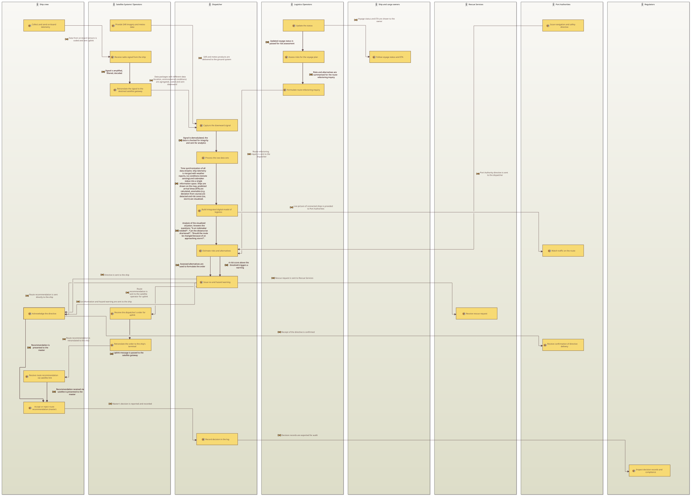
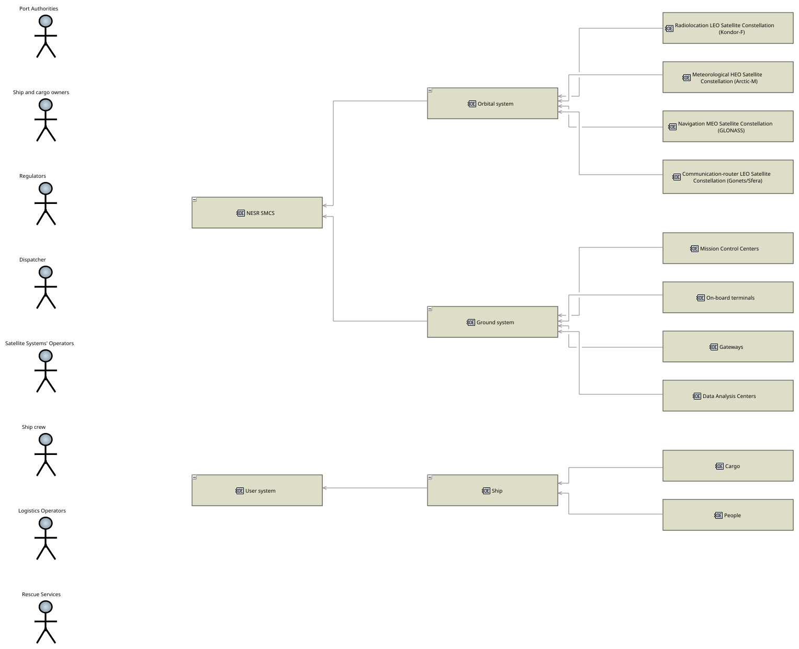
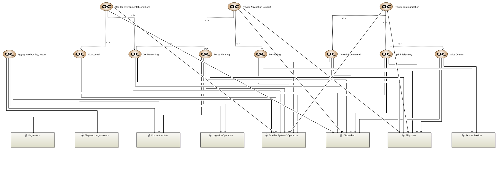

# Operational Analysis diagrams

Operational Analysis layer of the Capella model: operational entities, capabilities and activities. Exported from [MOD-001](../../capella/T3_MOD-001_Capella-Model.zip) v0.2.

| CI | Item | Files | Owner | Version | Status |
| --- | --- | --- | --- | --- | --- |
| MOD-002 | OAB Operational Architecture Blank: activities of the ship coordination scenario in the entity lanes | [svg](T3_MOD-002_OAB-Operational-Architecture.svg), [png](T3_MOD-002_OAB-Operational-Architecture.png) | Vladislav Zagorodnyuk | v0.2 | Draft |
| MOD-003 | OEBD Operational Entity Breakdown: 23 entities and actors | [svg](T3_MOD-003_OEBD-Operational-Entities.svg), [png](T3_MOD-003_OEBD-Operational-Entities.png) | Vladislav Zagorodnyuk | v0.2 | Draft |
| MOD-004 | OCB Operational Capabilities Blank: 11 operational capabilities | [svg](T3_MOD-004_OCB-Operational-Capabilities.svg), [png](T3_MOD-004_OCB-Operational-Capabilities.png) | Vladislav Zagorodnyuk | v0.2 | Draft |

In v0.2 the GLONASS constellation is labelled MEO, not GSO.

### MOD-002 OAB Operational Architecture Blank

### MOD-003 OEBD Operational Entity Breakdown

### MOD-004 OCB Operational Capabilities Blank

File names, versions and reviews: see [CONTRIBUTING.md](../../../CONTRIBUTING.md).
