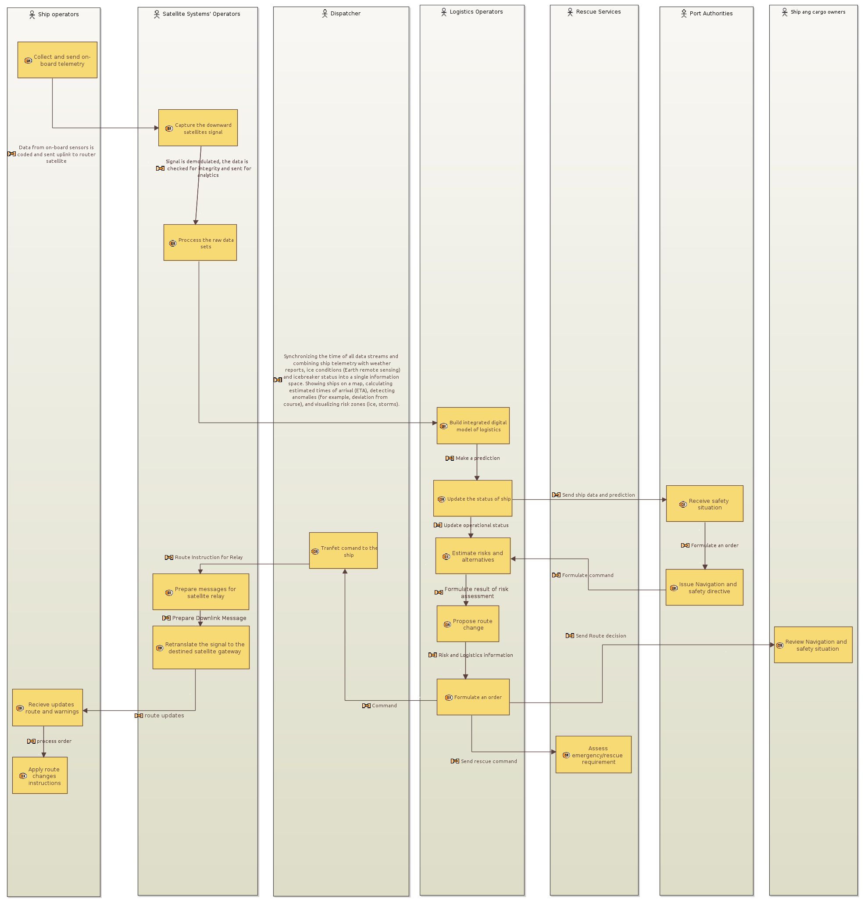
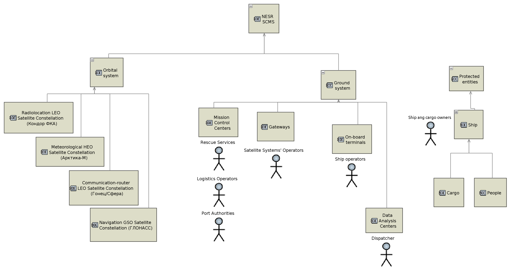
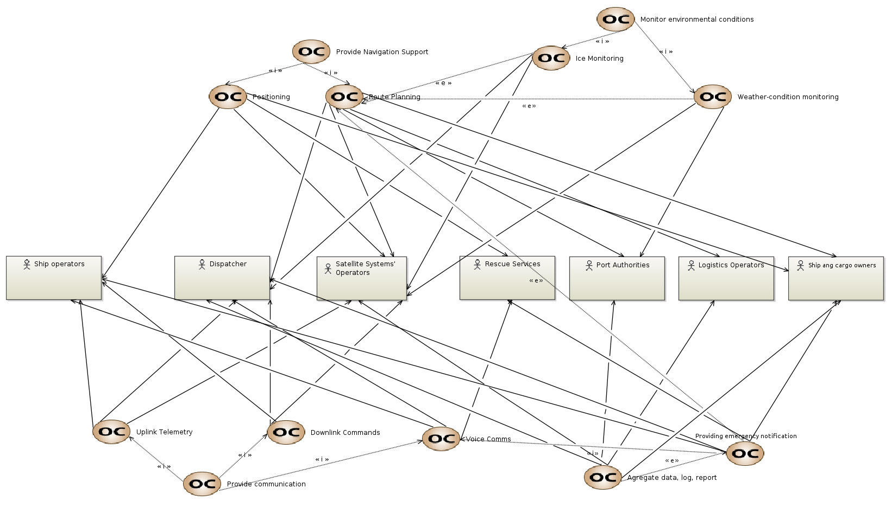

# Operational Analysis diagrams

Operational Analysis layer of the Capella model: operational entities, capabilities and activities.

| CI | Item | Files | Owner | Version | Status |
| --- | --- | --- | --- | --- | --- |
| MOD-002 | OAB Operational Architecture Blank | [png](T3_MOD-002_OAB-Operational-Architecture.png) | Vladislav Zagorodnyuk | v0.1 | Draft |
| MOD-003 | OEBD Operational Entity Breakdown | [png](T3_MOD-003_OEBD-Operational-Entities.png) | Vladislav Zagorodnyuk | v0.1 | Draft |
| MOD-004 | OCB Operational Capabilities Blank | [png](T3_MOD-004_OCB-Operational-Capabilities.png) | Vladislav Zagorodnyuk | v0.1 | Draft |

### MOD-002 OAB Operational Architecture Blank

### MOD-003 OEBD Operational Entity Breakdown

### MOD-004 OCB Operational Capabilities Blank

File names, versions and reviews: see [CONTRIBUTING.md](../../../CONTRIBUTING.md).
