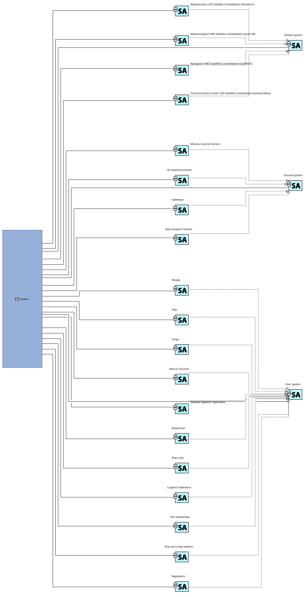
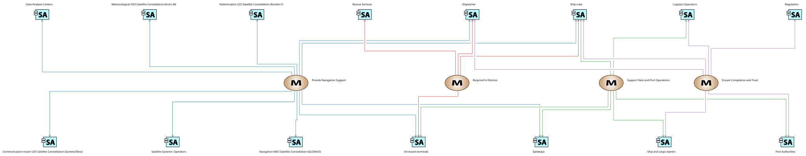
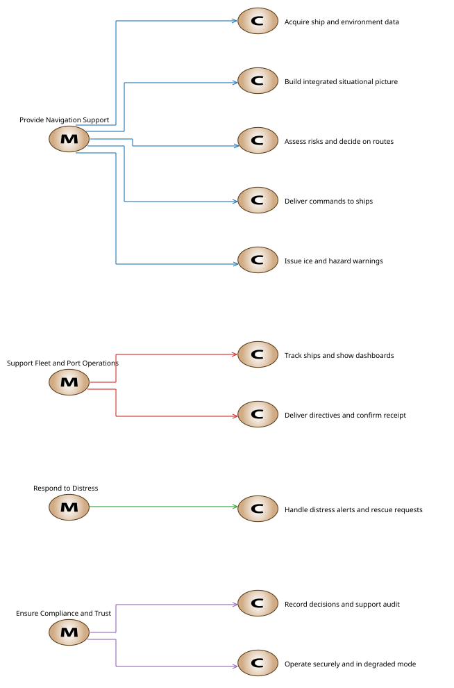
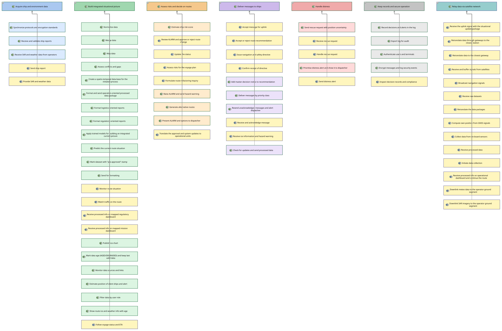
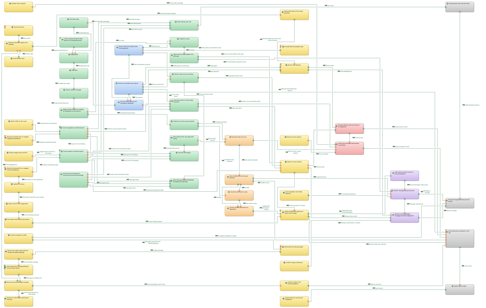
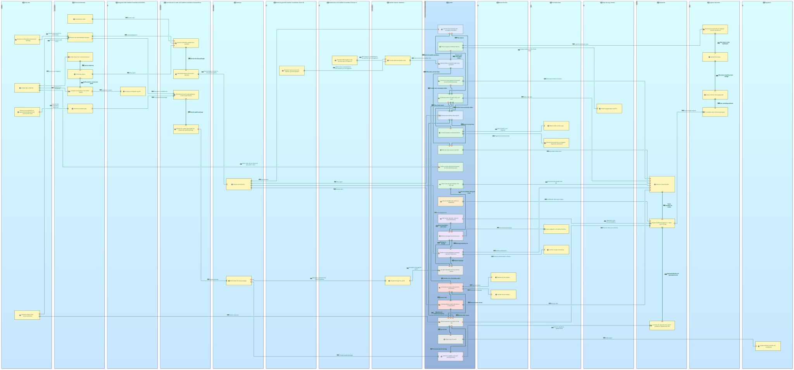

# System Analysis diagrams

System Analysis layer: missions and capabilities (MB, MCB), system actors (CSA), the function breakdown (SFBD), the data flow with the functional chains (SDFB), the system architecture (SAB) and the exchange scenarios (ES). Exported from [MOD-001](../../capella/T3_MOD-001_Capella-Model.zip) v0.2: 22 actors, 71 leaf functions, 107 functional exchanges, 10 capabilities, 4 functional chains, 7 scenarios.

| CI | Item | Files | Owner | Version | Status |
| --- | --- | --- | --- | --- | --- |
| MOD-005 | CSA Contextual System Actors | [svg](T3_MOD-005_CSA-Contextual-System-Actors.svg), [png](T3_MOD-005_CSA-Contextual-System-Actors.png) | Vladislav Zagorodnyuk | v0.2 | Draft |
| MOD-006 | SDFB Root System Function with the functional chains S1, S3a, S3b, S6 | [svg](T3_MOD-006_SDFB-Root-System-Function.svg), [png](T3_MOD-006_SDFB-Root-System-Function.png) | Vladislav Zagorodnyuk | v0.2 | Draft |
| MOD-007 | SAB System Architecture Blank: all functions in the actor lanes, including the on-board terminal, the constellations and the gateways | [svg](T3_MOD-007_SAB-System-Architecture.svg), [png](T3_MOD-007_SAB-System-Architecture.png) | Vladislav Zagorodnyuk | v0.2 | Draft |
| MOD-008 | System Analysis diagrams package submitted for problem set 2 | [pdf](T3_MOD-008_System-Analysis-Diagrams.pdf) | Vladislav Zagorodnyuk | v0.1 | Superseded by the v0.2 exports |
| MOD-009 | Exchange scenarios (ES): 7 scenarios | svg and png, listed below | Vladislav Zagorodnyuk | v0.2 | Draft |
| MOD-011 | MB Missions Blank: 4 missions | [svg](T3_MOD-011_MB-Missions.svg), [png](T3_MOD-011_MB-Missions.png) | Vladislav Zagorodnyuk | v0.2 | Draft |
| MOD-012 | MCB Capabilities Blank: 10 capabilities against the missions | [svg](T3_MOD-012_MCB-Capabilities.svg), [png](T3_MOD-012_MCB-Capabilities.png) | Vladislav Zagorodnyuk | v0.2 | Draft |
| MOD-013 | SFBD System Function Breakdown: 7 function groups | [svg](T3_MOD-013_SFBD-System-Function-Breakdown.svg), [png](T3_MOD-013_SFBD-System-Function-Breakdown.png) | Vladislav Zagorodnyuk | v0.2 | Draft |

## MOD-009 Exchange scenarios

| Scenario | Capability | Files |
| --- | --- | --- |
| Nominal monitoring cycle | Build integrated situational picture | [svg](T3_MOD-009_ES-Nominal-Monitoring-Cycle.svg), [png](T3_MOD-009_ES-Nominal-Monitoring-Cycle.png) |
| ALARM, route change and delivery to ship | Assess risks and decide on routes | [svg](T3_MOD-009_ES-ALARM-Route-Change.svg), [png](T3_MOD-009_ES-ALARM-Route-Change.png) |
| Silent ship | Track ships and show dashboards | [svg](T3_MOD-009_ES-Silent-Ship.svg), [png](T3_MOD-009_ES-Silent-Ship.png) |
| Port Authority directive with resend | Deliver directives and confirm receipt | [svg](T3_MOD-009_ES-Port-Authority-Directive.svg), [png](T3_MOD-009_ES-Port-Authority-Directive.png) |
| Distress alert and rescue request | Handle distress alerts and rescue requests | [svg](T3_MOD-009_ES-Distress-Alert-and-Rescue.svg), [png](T3_MOD-009_ES-Distress-Alert-and-Rescue.png) |
| Regulator audit of decision log | Record decisions and support audit | [svg](T3_MOD-009_ES-Regulator-Audit.svg), [png](T3_MOD-009_ES-Regulator-Audit.png) |
| Degraded mode: data source lost | Operate securely and in degraded mode | [svg](T3_MOD-009_ES-Degraded-Mode.svg), [png](T3_MOD-009_ES-Degraded-Mode.png) |

### MOD-005 CSA Contextual System Actors

### MOD-011 MB Missions Blank

### MOD-012 MCB Capabilities Blank

### MOD-013 SFBD System Function Breakdown

### MOD-006 SDFB Root System Function

### MOD-007 SAB System Architecture Blank

About 6900 × 3200 px: open the SVG and zoom in rather than reading the preview.

File names, versions and reviews: see [CONTRIBUTING.md](../../../CONTRIBUTING.md).
