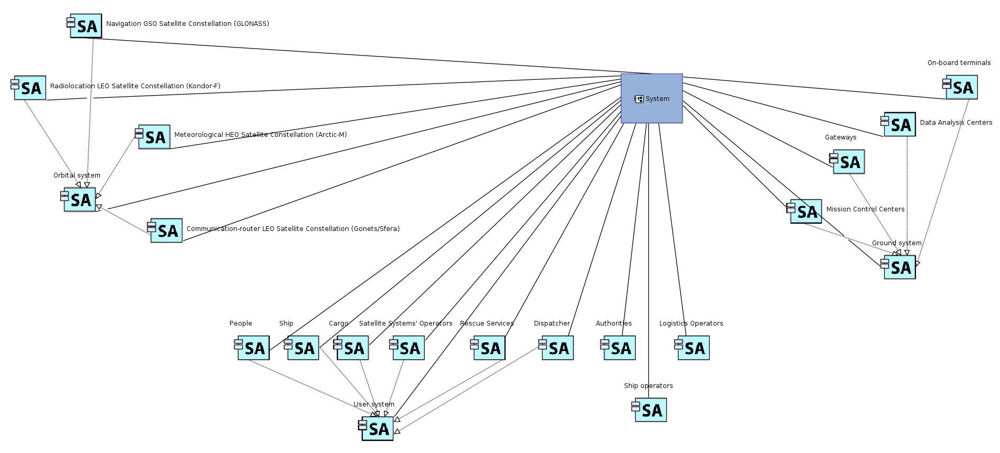
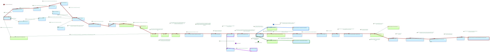
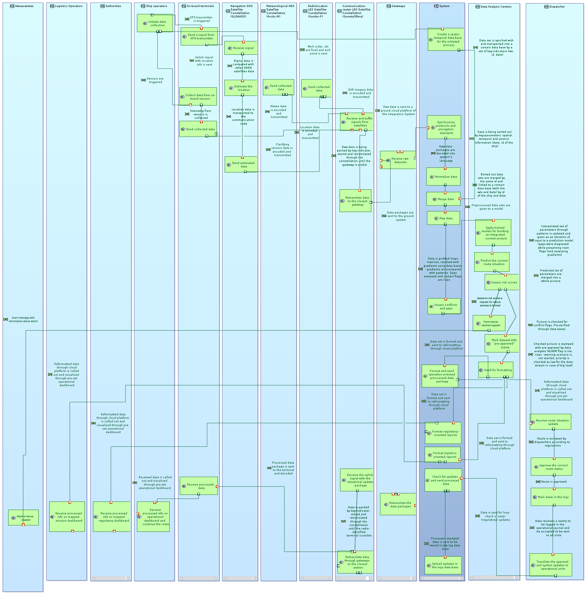

# System Analysis diagrams

System Analysis layer: system actors (CSA), system functions with functional chains (SDFB), system architecture (SAB) and exchange scenarios (ES).

| CI | Item | Files | Owner | Version | Status |
| --- | --- | --- | --- | --- | --- |
| MOD-005 | CSA Contextual System Actors | [png](T3_MOD-005_CSA-Contextual-System-Actors.png) | Vladislav Zagorodnyuk | v0.1 | Draft |
| MOD-006 | SDFB with functional chains S1, S3a, S3b, S6 | [svg](T3_MOD-006_SDFB-Root-System-Function.svg) | Vladislav Zagorodnyuk | v0.1 | Draft |
| MOD-007 | SAB System Architecture Blank | [png](T3_MOD-007_SAB-System-Architecture.png) | Vladislav Zagorodnyuk | v0.1 | Draft |
| MOD-008 | System Analysis diagrams package (CSA, SDFB, SAB) | [pdf](T3_MOD-008_System-Analysis-Diagrams.pdf) | Vladislav Zagorodnyuk | v0.1 | Draft |
| MOD-009 | Exchange scenarios (ES) for S2 and S6 | png (to add) | Vladislav Zagorodnyuk | - | Planned |

### MOD-005 CSA Contextual System Actors

### MOD-006 SDFB with functional chains S1, S3a, S3b, S6

### MOD-007 SAB System Architecture Blank

File names, versions and reviews: see [CONTRIBUTING.md](../../../CONTRIBUTING.md).
