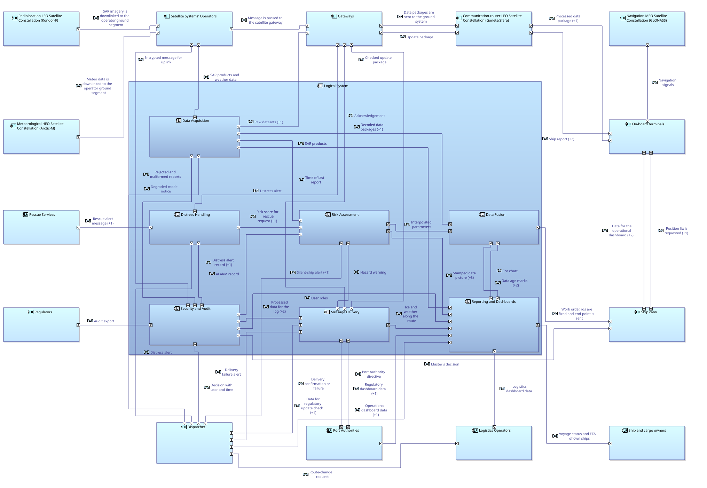
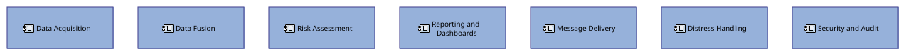
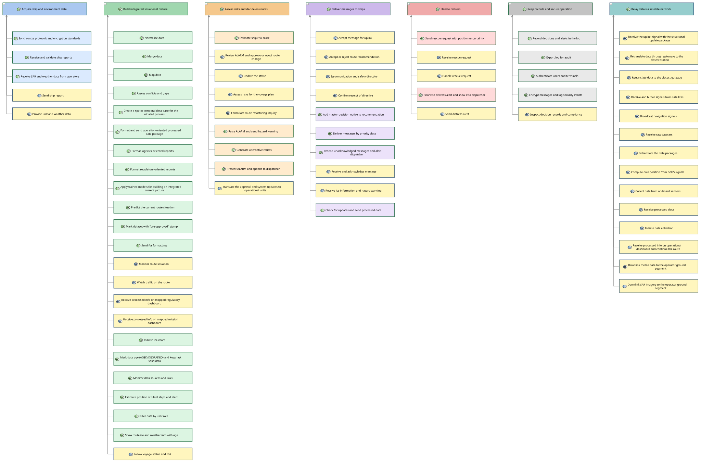
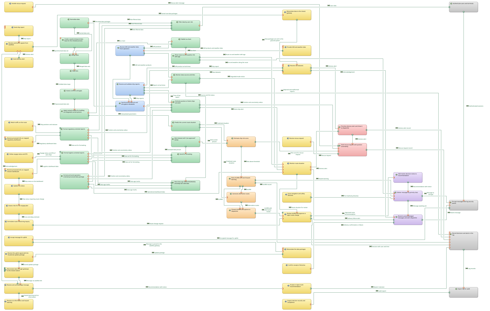

# Logical Architecture diagrams

Logical Architecture layer of the Capella model, exported from [MOD-001](../../capella/T3_MOD-001_Capella-Model.zip) v0.2. The Logical System is decomposed into 7 logical components; every system function is realized by a logical function and allocated to one of them.

| CI | Item | Files | Owner | Version | Status |
| --- | --- | --- | --- | --- | --- |
| MOD-010 | Logical architecture in Capella: LAB, LCBD, LFBD, LDFB | svg and png, listed below | Victoria Kulikova | v0.2 | Draft |

| Diagram | Content | Files |
| --- | --- | --- |
| LAB Logical Architecture Blank | 7 components inside the Logical System, 14 logical actors, 48 component exchanges | [svg](T3_MOD-010_LAB-Logical-Architecture.svg), [png](T3_MOD-010_LAB-Logical-Architecture.png) |
| LCBD Logical Component Breakdown | decomposition of the Logical System into the 7 components | [svg](T3_MOD-010_LCBD-Logical-Components.svg), [png](T3_MOD-010_LCBD-Logical-Components.png) |
| LFBD Logical Function Breakdown | 71 leaf logical functions in 7 groups | [svg](T3_MOD-010_LFBD-Logical-Functions.svg), [png](T3_MOD-010_LFBD-Logical-Functions.png) |
| LDFB Logical Data Flow Blank | 107 functional exchanges between the logical functions | [svg](T3_MOD-010_LDFB-Logical-Data-Flow.svg), [png](T3_MOD-010_LDFB-Logical-Data-Flow.png) |

The 7 components: Data Acquisition, Data Fusion, Risk Assessment, Reporting and Dashboards, Message Delivery, Distress Handling, Security and Audit. Traceability to the System Analysis is complete: FunctionRealization for every function, ComponentRealization for the system and the actors, PortRealization and FunctionalExchangeRealization for the ports and exchanges.

Still open:

- [ ] Highlight the functional chains S1, S2 and S6 on the LAB: there are no functional chains at the Logical Architecture level yet.
- [ ] Capability realizations and scenarios at the Logical Architecture level.

### LAB Logical Architecture Blank

### LCBD Logical Component Breakdown

### LFBD Logical Function Breakdown

### LDFB Logical Data Flow Blank

File names, versions and reviews: see [CONTRIBUTING.md](../../../CONTRIBUTING.md).
