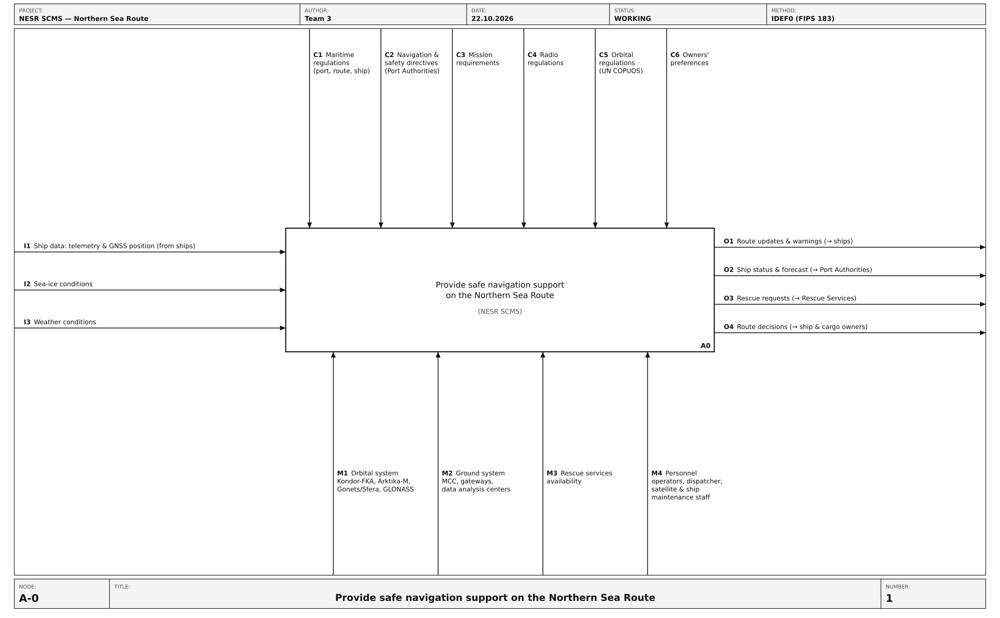
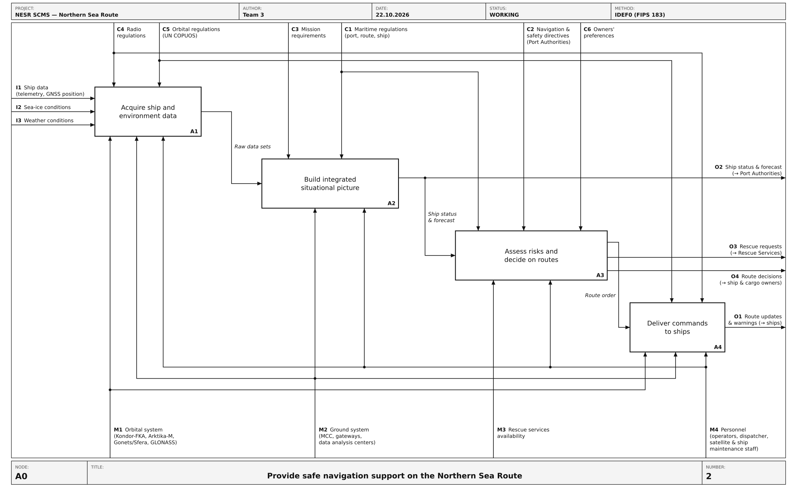
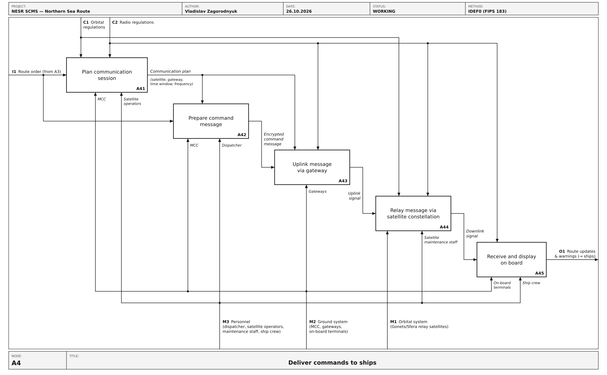

# IDEF0 functional analysis

IDEF0 functional analysis of the system: context (A-0), first-level decomposition (A0) and the A4 *Deliver commands to ships* decomposition.

| CI | Item | Files | Owner | Version | Status |
| --- | --- | --- | --- | --- | --- |
| ARC-001 | IDEF0 A-0 context diagram | [svg](T3_ARC-001_IDEF0-A-0-Context.svg) · [png](T3_ARC-001_IDEF0-A-0-Context.png) | Victoria Kulikova | v0.1 | Draft |
| ARC-002 | IDEF0 A0 decomposition | [svg](T3_ARC-002_IDEF0-A0-Decomposition.svg) · [png](T3_ARC-002_IDEF0-A0-Decomposition.png) | Victoria Kulikova | v0.1 | Draft |
| ARC-003 | IDEF0 A4 Deliver commands to ships | [svg](T3_ARC-003_IDEF0-A4-Deliver-Commands.svg) · [png](T3_ARC-003_IDEF0-A4-Deliver-Commands.png) | Vladislav Zagorodnyuk | v0.1 | Draft |

### ARC-001 IDEF0 A-0 context diagram

### ARC-002 IDEF0 A0 decomposition

### ARC-003 IDEF0 A4 Deliver commands to ships

File names, versions and reviews: see [CONTRIBUTING.md](../../CONTRIBUTING.md).
