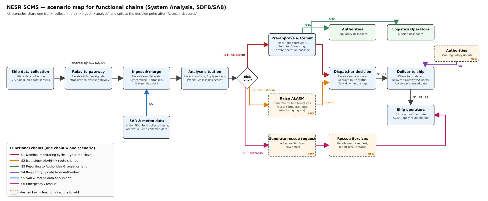

# 02 Concept of Operations (PDR deliverable 2)

**Deliverable:** ConOps of the proposed system. **Owner:** Jash Joshi.

| CI | Item | Files | Owner | Version | Status |
| --- | --- | --- | --- | --- | --- |
| CON-001 | Concept of operations | [md](T3_CON-001_ConOps.md) | Jash Joshi | v0.1 | Draft |
| CON-002 | Scenario map: functional chains S1 to S6 | [svg](T3_CON-002_Scenario-Map.svg) · [png](T3_CON-002_Scenario-Map.png) | Vladislav Zagorodnyuk | v0.1 | Draft |

### CON-002 Scenario map: functional chains S1 to S6

File names, versions and reviews: see [CONTRIBUTING.md](../CONTRIBUTING.md).
